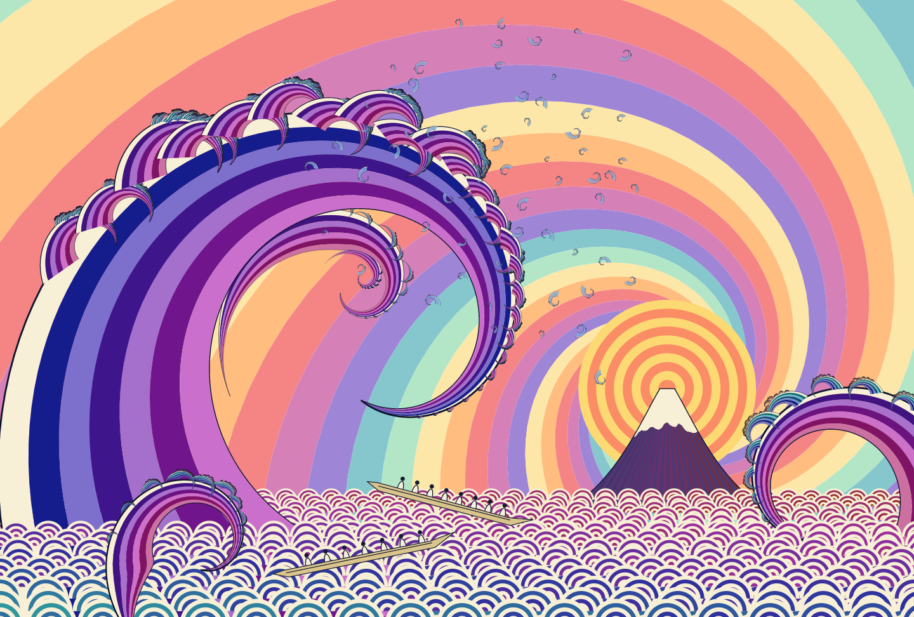
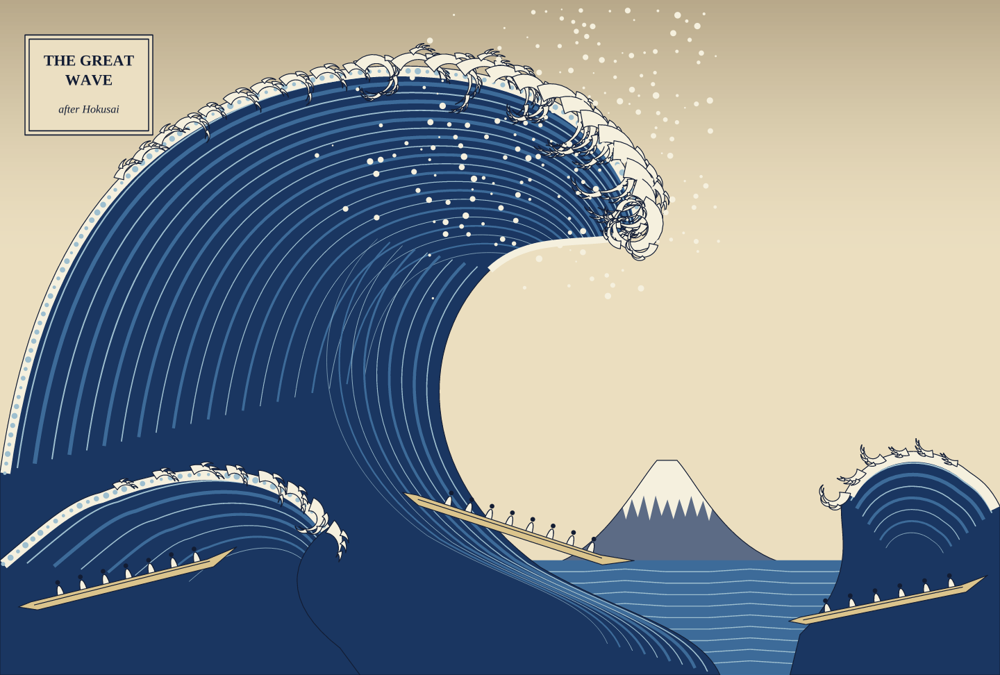

# kanagawa_wave

Images inspired by Katsushika Hokusai's *The Great Wave off Kanagawa*
(c. 1831), written in PostScript and rendered with
[pscat](https://github.com/PSCatLabs/pscat). An ArtColony project.



**`gallery/fractal_wave.ps`** follows the print's self-similarity until it
turns psychedelic. Every wave is one `kw-curl` (`lib/kw_fractal.ps`): a
striped band along a logarithmic spiral whose crest grows smaller copies of
itself. Each level winds less than its parent, so the copies read as
hooks, and the hue turns with depth (Prussian blue, then violet, teal,
magenta, gold). The great wave's cave holds a smaller copy of the wave,
and that copy holds another (a Droste recursion). The spray is tiny curls,
the sky winds round Fuji on the same spiral, and the sea is seigaiha.



**`gallery/great_wave.ps`** is a quieter homage closer to the woodblock. The
wave bodies are Bezier shapes with concentric streaks, the foam rims are
laced with `alongpath` dots, and the crest's claws come from `kw-claw`: a
tapered, curling finger that sprouts smaller fingers of its own.

## Setup

This repo uses the **released** pscat at the version pinned in
`.pscat-version`. That is currently a 0.7 release candidate, the build the
project started on: 0.6.x lacks the native noise operators (`fbm2` and
friends) and the embedded standard-35 fonts that later pieces will want. Install it from the
[releases page](https://github.com/PSCatLabs/pscat/releases):

```sh
v=$(cat .pscat-version)
t=aarch64-apple-darwin          # or x86_64-apple-darwin, x86_64-unknown-linux-musl, ...
gh release download "v$v" -R PSCatLabs/pscat -p "pscat-$v-$t.tar.gz" -p SHA256SUMS
shasum -a 256 -c SHA256SUMS --ignore-missing
tar xzf "pscat-$v-$t.tar.gz"
# keep the bundle together and put pscat and pscat-mcp on your PATH
pscat --version
```

## Rendering

```sh
scripts/render.sh                                  # every gallery piece -> renders/
scripts/render.sh -D Seed=4 gallery/great_wave.ps  # another seed
scripts/render.sh -D Kscale=0.4 gallery/fractal_wave.ps  # bigger crest curls
DPI=144 scripts/render.sh gallery/great_wave.ps    # 2x
scripts/render.sh --sweep-seed 1:9 gallery/great_wave.ps   # contact sheet
```

Renders go to `renders/` (git-ignored). If disk space is tight, set
`KW_RENDERS` (and `TMPDIR`) to a directory on roomier storage.

## Layout

| Path | What |
|---|---|
| `gallery/*.ps` | Pieces, one file each: `fractal_wave.ps`, `great_wave.ps` |
| `gallery/previews/` | Chosen renders, committed by hand |
| `lib/kw_fractal.ps` | `kw-curl`: the recursive log-spiral wave, with its options (`kw-fturn`, `kw-fturnk`, `kw-fkids`, `kw-fscale`, `kw-fprofile`, `kw-fbehind`, `kw-framp`, `kw-fcolor`) |
| `lib/kw_wave.ps` | Wave procedures: Bezier helpers, `kw-claw`, `kw-crest`, `kw-boat`; load with `(lib/kw_wave.ps) run` from the repo root |
| `scripts/render.sh` | Render with strict lint and timing; `-D Name=value`, `--sweep-seed` |
| `docs/pscat-issues.md` | pscat bugs and requests found here, each filed upstream |
| `.claude/skills/` | The `pscat`, `psart` and `psviz` agent skills, copied from the pinned pscat tag |
| `.github/workflows/ci.yml` | Renders every piece with the pinned pscat on each PR |

## License

CC0-1.0. Hokusai's print is in the public domain.
