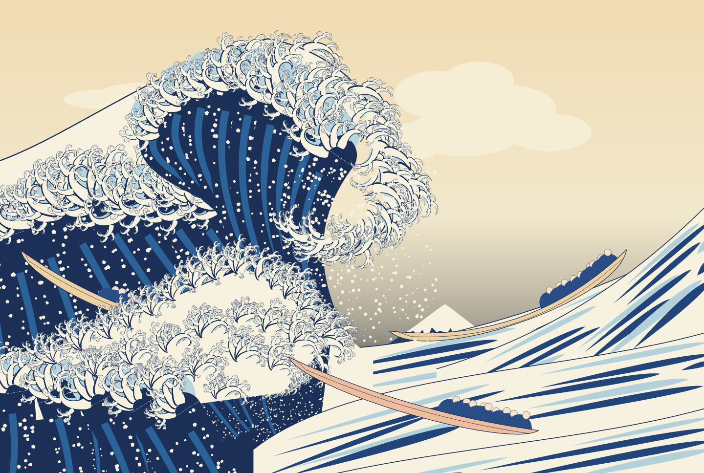
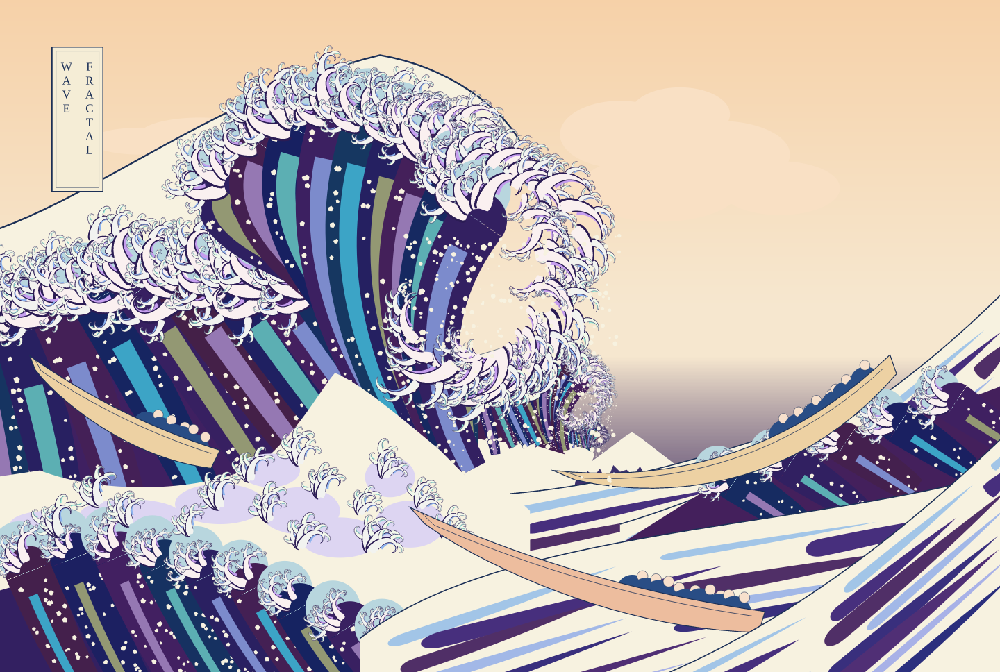
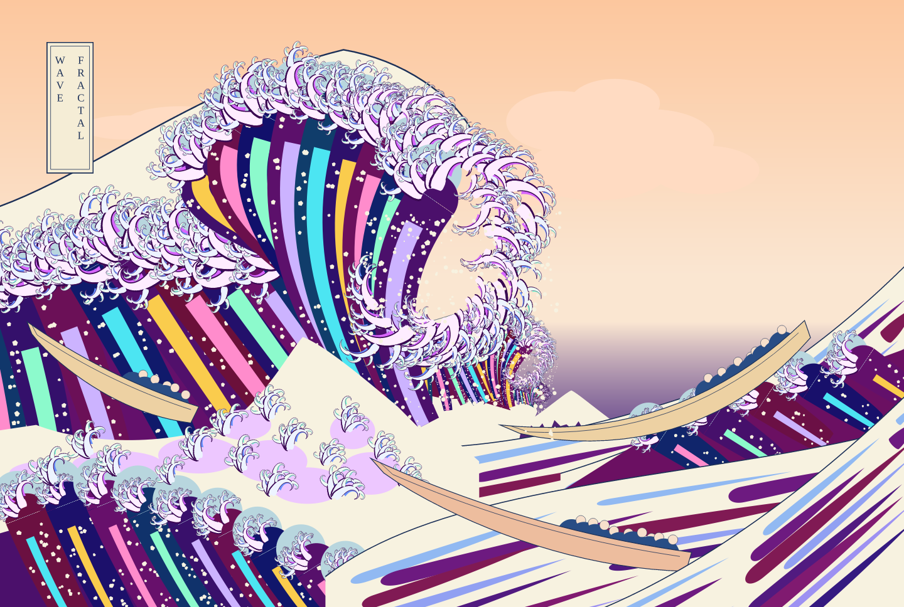
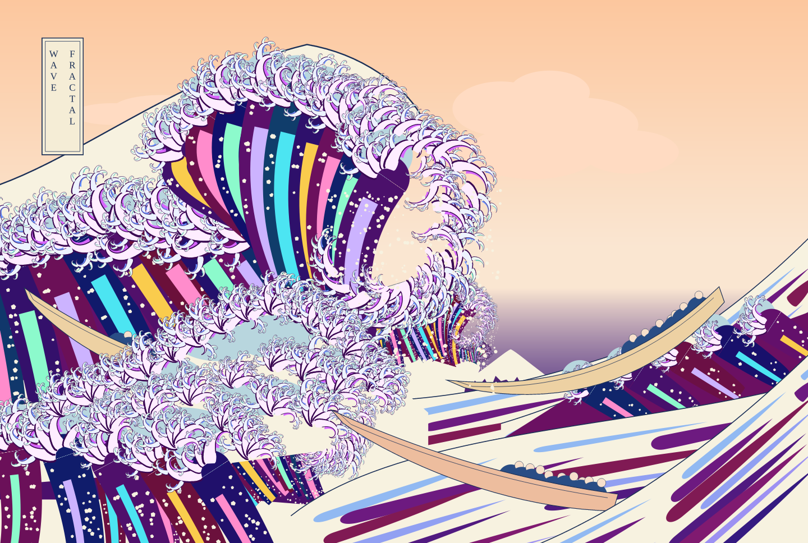
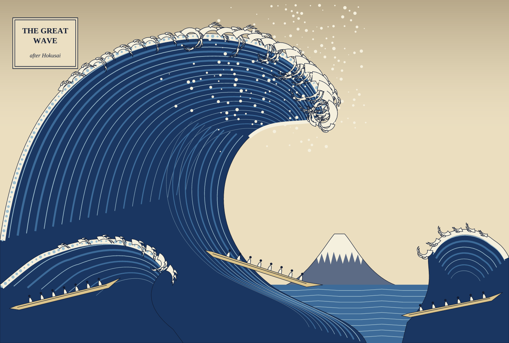

# Gallery

Every piece is one PostScript file in this folder, rendered with
[pscat](https://github.com/PSCatLabs/pscat) (`scripts/render.sh` from the repo
root; see the [main README](../README.md) for setup). The images below are
committed previews in [`previews/`](previews/), rendered at 2x (`DPI=144`).

## fractal_wave — [`fractal_wave.ps`](fractal_wave.ps)

Hokusai's *Great Wave*, laid out on the Met's public-domain scan, with its
self-similarity followed down: each foam claw sprouts claws (`kw-talon` in
[`lib/kw_foam.ps`](../lib/kw_foam.ps)), the crest is one giant claw made of
claws, and the cave can hold a smaller great wave, which holds another.
Knobs: `Kpsy` (0 = the print's palette .. 1 = psychedelic), `Kfore` (1 = the
foreground is the great wave again at half size), `Kdroste` (waves in the
cave), `Seed`.

**The print's palette** — `scripts/render.sh -D Kpsy=0 gallery/fractal_wave.ps`

**Halfway** — `-D Kpsy=0.5 -D Kfore=0`

**Psychedelic, the print's foreground** — `-D Kfore=0`

**Psychedelic, the default** — `scripts/render.sh gallery/fractal_wave.ps`:
the foreground is the great wave again, and two smaller waves nest in the cave

## great_wave — [`great_wave.ps`](great_wave.ps)

The project's first sketch, drawn from memory before the scan was measured:
Bezier wave bodies with concentric streaks, foam rims laced with `alongpath`
dots, and curling `kw-claw` fingers on the crest. `-D Seed=N` varies it.

